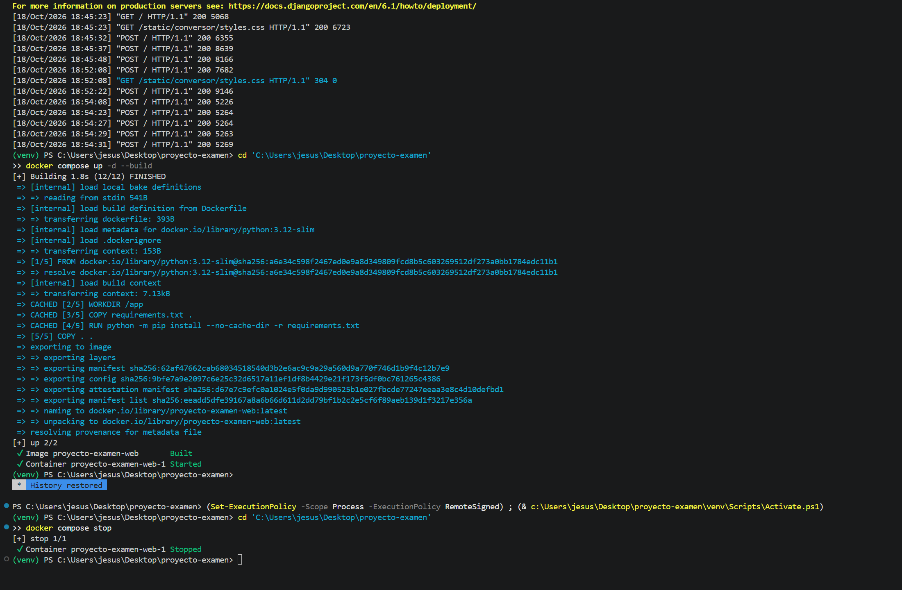

# Analizador de representación de datos

En este proyecto hice una aplicación web con Python y Django para trabajar con dos cosas: la representación de números en distintas bases y la forma en que se representan los caracteres usando Unicode y UTF-8. Después preparé la aplicación para ejecutarla desde Docker con Python 3.12, el puerto 8000 y los límites de recursos solicitados.

La página tiene dos formularios. En el primero se ingresa un número y se selecciona su base de origen; en el segundo se ingresa un texto de hasta 20 caracteres. Cada formulario muestra sus resultados o un mensaje que explica qué se debe corregir.

## Qué se hizo y cómo funciona

Para organizar el proyecto, separé los cálculos, los formularios y la presentación de los resultados. Los cálculos están en `conversor/conversiones.py`, las validaciones de los formularios en `conversor/forms.py` y la recepción de las solicitudes en `conversor/views.py`. La página se presenta con una plantilla HTML y una hoja de estilos.

El formulario numérico acepta las bases 2, 8, 10 y 16. Primero revisa que los dígitos correspondan a la base seleccionada y que el valor esté entre 0 y 65 535. Luego muestra ese mismo valor en decimal, binario, octal y hexadecimal. También calcula los bits significativos y los bytes necesarios.

Por ejemplo, al ingresar `13` en base 10, el resultado es decimal `13`, binario `00001101`, octal `15` y hexadecimal `D`. Tiene cuatro bits significativos y necesita un byte. Los ceros que aparecen a la izquierda completan el grupo de ocho bits y no cambian el valor. Si el número necesita más de ocho bits, se completa hasta dieciséis. Con el máximo permitido en este ejercicio no se llega a veinticuatro bits.

El formulario de texto muestra una fila por cada punto de código Unicode: el carácter, su código decimal, su punto de código U+, el valor hexadecimal y sus bytes UTF-8. Por ejemplo, la `ñ` tiene el código decimal `241`, el punto `U+00F1`, el hexadecimal `F1` y los bytes UTF-8 `C3 B1`. Esto permite ver que un carácter puede necesitar más de un byte.

Se agregaron mensajes para entradas vacías, dígitos inválidos, números negativos, valores fuera del rango y textos de más de veinte caracteres. También se incluyeron 32 pruebas automatizadas para comprobar las conversiones, los errores, el análisis del texto, los formularios y las respuestas de la página.

## Ejecutar

En una terminal de PowerShell:

```powershell
Set-Location 'C:\Users\jesus\Desktop\proyecto-examen'
.\venv\Scripts\python.exe manage.py runserver
```

Abre http://127.0.0.1:8000/ en el navegador. Deja la terminal abierta mientras usas la página. Para detenerla, pulsa Ctrl+C en esa terminal.

El comando usa directamente el Python del entorno virtual del proyecto. Si ya activaste ese entorno, también puedes usar `python manage.py runserver`.

## Ejecutar con Docker (Python 3.12)

Necesitas Docker Desktop abierto, con su motor iniciado y configurado para contenedores Linux. Docker ejecuta una copia del proyecto dentro de un contenedor; no necesitas activar el entorno `venv` para estos comandos.

Si Django sigue ejecutándose desde Visual Studio o desde otra terminal, detén ese servidor con **Ctrl+C en su terminal** antes de iniciar el contenedor. Ambos intentan usar el puerto 8000.

Abre PowerShell y entra en la carpeta que contiene `Dockerfile` y `compose.yaml`. En esta computadora la ruta es la siguiente; si descargas el proyecto en otro equipo, usa la ruta donde lo hayas guardado:

```powershell
Set-Location 'C:\Users\jesus\Desktop\proyecto-examen'
```

Construye la imagen. Este paso prepara Python 3.12, instala las dependencias y copia el proyecto; la primera vez puede tardar varios minutos:

```powershell
docker compose build
```

Inicia el contenedor en segundo plano:

```powershell
docker compose up -d
```

El `Dockerfile` parte de `python:3.12-slim`, instala las dependencias indicadas en `requirements.txt` y copia los archivos del proyecto. El arranque aplica las migraciones de Django y luego inicia el servidor de desarrollo en `0.0.0.0:8000`.

Abre [http://127.0.0.1:8000/](http://127.0.0.1:8000/). El archivo `compose.yaml` publica el puerto mediante `127.0.0.1:8000:8000` y establece los límites de memoria y CPU.

La opción `-d` deja el contenedor funcionando en segundo plano. Por eso la página puede seguir abierta aunque se cierre Visual Studio Code o la terminal.

Comprueba que el servicio `web` esté en ejecución y que dentro se use Python 3.12:

```powershell
docker compose ps
docker compose exec web python --version
```

Ejecuta las pruebas dentro del contenedor:

```powershell
docker compose exec web python manage.py test conversor -v 2
```

Cada prueba comprueba automáticamente una entrada y su resultado esperado. Si todas pasan, la salida termina en `OK`. Se incluyen conversiones válidas, validación de bases y rango, y la codificación UTF-8 de `ñ`.

Consulta los mensajes del servidor si el contenedor no arranca o la página no responde:

```powershell
docker compose logs --tail 50 web
```

Si aparece un error que indica que el puerto 8000 está ocupado, detén el servidor local que lo usa desde su propia terminal y vuelve a ejecutar `docker compose up -d`.

Para detener la aplicación y conservar el contenedor:

```powershell
docker compose stop
```

Para volver a iniciarla:

```powershell
docker compose up -d
```

Para detener y retirar el contenedor del proyecto:

```powershell
docker compose down
```

En siguientes ejecuciones basta con `docker compose up -d`. Si cambias el código o las dependencias, repite `docker compose build` y después `docker compose up -d` para usar la nueva imagen.

## Límites de recursos y evidencia

`compose.yaml` configura el servicio `web` con `mem_limit: 256m` y `cpus: 1.0`: un máximo de 256 MiB de RAM y el equivalente a una CPU. Son límites de uso; la aplicación puede consumir menos.

Con el contenedor en ejecución, consulta una muestra del consumo real:

```powershell
docker stats --no-stream
```

La columna `MEM USAGE / LIMIT` muestra el consumo y el límite de memoria. `CPU %` muestra el consumo en ese momento; el límite de CPU se verifica en la configuración del contenedor.

En una ejecución de verificación se confirmó Python 3.12.15 y Django 6.1.2 dentro del contenedor. Las 32 pruebas pasaron. También se comprobaron por HTTP una conversión válida, el error de dígitos en base 2, el análisis de `ñ` y la carga de los estilos.

Las evidencias se guardaron como archivos de texto para poder revisar las salidas completas:

| Evidencia | Qué permite comprobar |
| --- | --- |
| [Pruebas dentro de Docker](evidencias/pruebas_docker.txt) | Las versiones utilizadas y la ejecución de las 32 pruebas, terminando en `OK`. |
| [Salida de docker stats](evidencias/docker_stats.txt) | El consumo real de CPU y memoria durante la muestra, incluido el límite de 256 MiB. |
| [Límites efectivos del contenedor](evidencias/limites_docker.txt) | El estado registrado, el puerto 8000 y los límites de memoria y CPU consultados al contenedor. |
| [Comprobaciones de la página](evidencias/verificacion_web_docker.txt) | La página responde y presenta la conversión, la validación y el caso UTF-8 con `ñ`. |

Estos son algunos de los resultados guardados:

```text
Python 3.12.15
Django: 6.1.2

Ran 32 tests in 0.051s
OK
```

Resumen de la muestra real de `docker stats`:

| Contenedor | Uso de CPU en esa muestra | RAM utilizada / límite |
| --- | --- | --- |
| proyecto-examen-web-1 | 55.33 % | 55.41 MiB / 256 MiB |

La consulta de configuración registró `268435456` bytes de memoria, equivalentes a 256 MiB, y `1000000000` NanoCPUs, equivalentes al límite de una CPU. El porcentaje de CPU de la tabla es el consumo de ese momento; no es la configuración del límite.

Estas salidas corresponden a la ejecución verificada y permanecen guardadas aunque después se apague el contenedor. Para mostrarlo funcionando durante la revisión o el video, se vuelve a iniciar con `docker compose up -d` y se consultan los comandos de estado y recursos.

### Cómo presentar la evidencia con capturas

El enunciado pide evidencia de `docker stats` y no indica un formato específico. Aquí se adjunta la salida real en texto. Para facilitar la revisión, también se pueden agregar dos capturas legibles de la terminal:

1. Una captura después de ejecutar `docker compose ps` y `docker stats --no-stream`, donde se vea el contenedor en ejecución y la memoria utilizada frente al límite de 256 MiB.
2. Una captura del final de `docker compose exec web python manage.py test conversor -v 2`, donde se vean `Ran 32 tests` y `OK`.

Las capturas se pueden guardar en la carpeta `evidencias/` y subir junto con el proyecto. Deben corresponder a una ejecución real; los archivos de texto enlazados arriba ya contienen los resultados de la verificación realizada.

## Arquitectura de Von Neumann y contenedores

La CPU ejecuta las instrucciones de Python y Django que validan y convierten los datos. La RAM mantiene las instrucciones y los datos que están en uso, como las entradas y los resultados. Los formularios del navegador proporcionan la entrada, y las tablas y mensajes constituyen la salida. Esto se relaciona con la arquitectura de Von Neumann, en la que las instrucciones y los datos se almacenan en memoria y el procesador ejecuta las instrucciones.

El kernel es el núcleo del sistema operativo que administra procesos, memoria y otros recursos. Un contenedor Linux no inicia su propio kernel: ejecuta sus procesos usando el kernel Linux del entorno donde corre Docker. En Docker Desktop para Windows con WSL 2, comparte el kernel Linux de ese entorno, no el kernel de Windows directamente. El contenedor mantiene separados sus archivos y procesos mediante mecanismos de aislamiento del kernel.

Los bytes que se muestran para cada número describen su representación como dato. El límite de 256 MiB corresponde a la memoria de todo el contenedor: incluye Python, Django y los datos que están utilizando mientras la aplicación funciona.

## Uso

- **Números:** escribe un entero y selecciona su base de origen. Se permiten valores entre 0 y 65 535. Verás las cuatro bases, los bits significativos y los bytes necesarios.
- **Texto:** escribe hasta 20 caracteres. Verás su código decimal, punto de código Unicode, hexadecimal y bytes UTF-8. La ñ se codifica como `C3 B1`.
- Los formularios muestran un mensaje cuando falta una entrada o no cumple las reglas.
- El cero se presenta como `00000000`, con cero bits significativos y un byte.

No se guarda un historial ni se usa una base de datos para realizar los cálculos.

## Pruebas

Una prueba automatizada le da una entrada al programa y compara su respuesta con el resultado esperado. También hay pruebas que esperan que una entrada incorrecta sea rechazada. En ese caso, la prueba pasa cuando el programa muestra el error correspondiente.

Por ejemplo, se comprueba que `256` necesite nueve bits significativos y dos bytes, que `102` no sea válido en base 2, que `65536` se rechace por estar fuera del rango y que la `ñ` produzca los bytes `C3 B1`.

Para ejecutarlas con el entorno local que ya está preparado:

```powershell
.\venv\Scripts\python.exe manage.py test conversor -v 2
```

Para ejecutarlas con Python 3.12 dentro de Docker, con el contenedor iniciado:

```powershell
docker compose exec web python manage.py test conversor -v 2
```

## Archivos principales

- `conversor/conversiones.py`: cálculos y análisis de caracteres.
- `conversor/forms.py`: validación de las entradas.
- `conversor/views.py`: recibe los formularios y prepara la respuesta.
- `conversor/templates/conversor/index.html`: página de la aplicación.
- `conversor/static/conversor/styles.css`: estilos.
- `conversor/tests.py`: pruebas automatizadas.
- `Dockerfile`: preparación del entorno con Python 3.12 y arranque de Django.
- `compose.yaml`: ejecución del servicio, puerto 8000 y límites de recursos.
- `.dockerignore`: evita copiar el entorno virtual y otros archivos locales a la imagen.
- `requirements.txt`: versión de Django utilizada por el proyecto.
- `evidencias/`: resultados guardados de las verificaciones.

## Estado de la entrega

| Parte solicitada | Estado |
| --- | --- |
| Conversiones y ajuste a bytes | Implementados y cubiertos por pruebas. |
| Caracteres, Unicode y UTF-8 | Implementados, incluido el caso de `ñ`. |
| Validaciones y mensajes de error | Implementados y cubiertos por pruebas. |
| Estructura y funcionamiento de Django | La aplicación se ejecutó y se verificaron sus respuestas por HTTP. |
| Al menos seis pruebas automatizadas | Hay 32 y pasaron en la ejecución guardada dentro de Docker. |
| Dockerfile, Compose y límites | Preparados y verificados con 256 MiB y una CPU. |
| README, explicación técnica y evidencia | Documentados en este archivo y en la carpeta `evidencias/`. |
| Proyecto completo disponible por enlace | Falta subir la versión completa que está en la computadora. |
| Video de máximo dos minutos | Pendiente de grabar y adjuntar. |

El repositorio asociado es [JesusAndresHerrera/proyecto-examen](https://github.com/JesusAndresHerrera/proyecto-examen). Al revisar la entrega, el repositorio público todavía mostraba únicamente el README inicial y la carpeta `.vscode`. Por eso falta subir el código de Django, los archivos de Docker, este README actualizado y la carpeta de evidencias.

## Qué falta para entregar

1. Grabar el video de máximo dos minutos con una conversión válida, un error de validación, un texto con `ñ`, las pruebas aprobadas y el contenedor funcionando.
2. Subir la versión completa del proyecto a GitHub o a Google Drive, incluyendo el README y la carpeta `evidencias/`.
3. Adjuntar el video o agregar su enlace en este README.
4. Abrir el enlace de entrega desde una ventana privada para comprobar que se pueden consultar o descargar los archivos y ver el video.

Video de demostración: pendiente de grabar y adjuntar.

### Orden sugerido para el video

Conviene iniciar el contenedor antes de comenzar la grabación. Este orden permite mostrar lo solicitado en aproximadamente un minuto y cincuenta segundos:

| Tiempo | Qué mostrar |
| --- | --- |
| 0:00 a 0:20 | Ingresar `13` en base 10 y mostrar las cuatro representaciones, los bits y los bytes. |
| 0:20 a 0:35 | Ingresar `102` en base 2 y mostrar el mensaje de error. |
| 0:35 a 0:55 | Analizar `Año` y señalar los bytes UTF-8 `C3 B1` de la `ñ`. |
| 0:55 a 1:20 | Ejecutar las pruebas dentro de Docker y mostrar que terminan con `32 tests` y `OK`. |
| 1:20 a 1:50 | Mostrar `docker compose ps` y `docker stats --no-stream`, con el contenedor en ejecución y el límite de memoria. |



https://youtu.be/DS3Fg2jlKH4